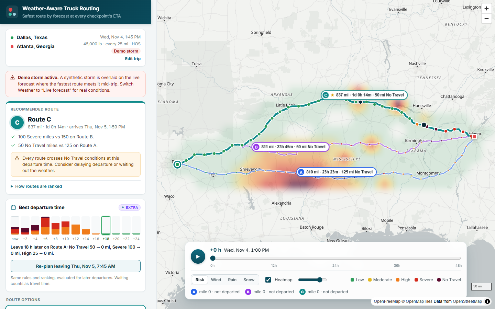
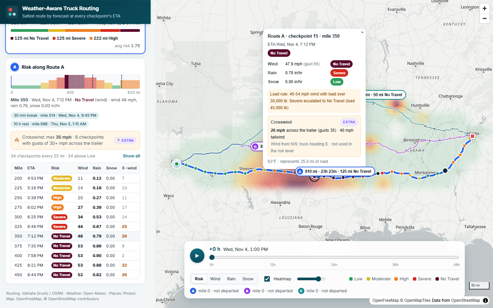
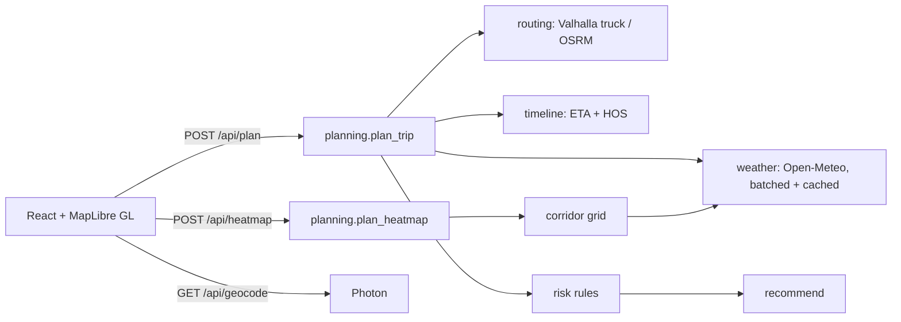

# Weather-Aware Truck Routing

A React + Django app that helps a truck driver choose the safest route. It generates **three route options**, samples the forecast at every checkpoint **at the truck's ETA**, classifies risk with the provided **risk and load rules**, recommends the best route, and shows a **0–48 h weather heatmap** along the trip corridor.

- **Live app:** https://weather-truck-routing-bfe4.onrender.com/ (free hosting: the first visit after a quiet spell takes 30–60 seconds while the server wakes up)
- **Walkthrough (Loom):** https://www.loom.com/share/2c4c787952744fff8202b19cfa0ee2df

| Recommendation with a demo storm and a 45,000 lb load | Checkpoint details and risk profile |
|---|---|
|  |  |

---

## What it does

| Requirement | How it is met |
|---|---|
| Origin, destination, departure, load | Address autocomplete (or `lat, lon`), local date/time, load in lb with presets on both sides of the load-rule thresholds. |
| 3 route options from a routing API | Valhalla **truck** routing with the gross weight. If fewer than 3 alternatives come back, distinct detours are generated through via points (see below). OSRM is the fallback. |
| Weather every 10 / 25 / 50 miles at the truck's ETA | Checkpoints at every interval mark plus the destination. Each one gets the hourly forecast **for the moment the truck reaches it**, including mandatory HOS rest stops. |
| Risk from the rules | Exact table and load rules, with documented boundary handling and 41 boundary tests. |
| Recommend the best route | Lexicographic ranking in the spec's order, with a plain-English reason for each comparison. |
| Map: routes, checkpoints, risk, ETAs, summaries | All routes and all checkpoints are colored by risk, with a summary chip on each route. Hover or click gives full checkpoint detail, and HOS stops are marked. |
| Corridor heatmap with a 0–48 h slider | Grid aligned with Web Mercator along the corridor, 49 pre-rendered GPU frames, cross-faded playback at 60 fps, and trucks animated along their routes. |

There is also a clearly labeled **"Demo storm"** weather option. It overlays a synthetic storm on the live forecast so the risk rules, load rules and ranking can be seen working even on a calm day. Live forecast is the default.

## Extra features

These go beyond the brief. They are marked **Extra** in the UI, and none of them changes a risk level or the ranking.

- **Best departure time.** The same rules and ranking are re-run for departures every 2 hours over the next 24. When a later start reduces No Travel, Severe or High miles, the app suggests the earliest such departure, for example "Leave 18 h later on Route A: No Travel 50 → 0 mi, Severe 100 → 0 mi". One click re-plans with it. Average risk alone never justifies waiting, and waiting counts toward travel time. No extra weather calls are needed, because the same checkpoint forecasts are fetched with a 24-hour longer window.
- **Crosswind.** The forecast wind direction is compared with the truck's heading at each checkpoint. The app shows crosswind, headwind or tailwind, and flags gusts of 30 mph or more across the trailer. This is information only: the risk table classifies plain wind speed, exactly as the spec defines.
- **Trucks on the timeline.** Each route's truck moves with the 0–48 h slider and stays parked during HOS stops, so you can watch it meet, or miss, the weather.

## Architecture



```
backend/planner/
  domain/        pure logic, no I/O, fully unit-tested
    risk.py        risk table + load rules
    recommend.py   ranking + explanations
    timeline.py    distance -> ETA, HOS stops, truck speed cap
    geo.py         polylines, checkpoints, overlap, simplification
    corridor.py    heatmap grid along the trip corridor
    scenario.py    optional demo storm
    departure.py   extra: best departure time (same ranking, later departures)
    crosswind.py   extra: wind relative to the truck's heading (informational)
  services/      third-party I/O (routing, weather, geocoding, HTTP session)
  api/           DRF serializers, views, uniform JSON errors
  planning.py    the two use cases that tie it together
frontend/src/
  components/    MapView, TripForm, PlaceInput, RoutePanel, RiskProfile, TimeControl
  lib/           heatmap rasterizer, risk scales, truck interpolation, formatting
  hooks/         useHeatFrames (chunked, cached frame rendering)
```

The backend is stateless: no database, and provider responses are cached. One container serves the API and the built React app.

## How the logic works

### 1. Three routes

1. Valhalla `truck` costing is called with `alternates=2`. It uses the gross weight, which is the load plus a 35,000 lb tractor-trailer, and a 65 mph speed governor.
2. Public routers rarely return three alternatives on long trips. When fewer come back, candidate detours are generated through via points offset to either side of the trip's midsection. Those points snap only to primary roads or larger, so detours follow real highway corridors.
3. A candidate is kept only if all of these hold:
   - At most 80% of it overlaps an accepted route, in either direction.
   - It takes no more than 1.6 times the fastest route's time.
   - It doesn't double back on itself, which catches via points that snapped onto dead ends.
4. **Fallback.** The free Valhalla server caps requests at about 930 miles straight-line, and it can be unavailable. In either case the whole selection reruns on OSRM, re-timed with the same 65 mph cap. All three options always come from one provider, so their travel times are comparable.

Routes are labeled A, B and C from fastest to slowest.

### 2. Checkpoints and ETAs

- **Placement.** Checkpoints sit at mile 0, then every 10, 25 or 50 miles, then at the destination. Gaps never exceed the interval.
- **Timing.** Router time is spread over the route geometry maneuver by maneuver, so time grows smoothly with distance.
- **HOS model.** The simplified FMCSA hours-of-service model is on by default and can be switched off:
  - A 30-minute break after 8 hours of driving.
  - A 10-hour rest after 11 hours.
  - Breaks are inserted into the timeline, so later checkpoints get later ETAs. Weather is therefore sampled when the truck actually arrives.

### 3. Weather at the ETA

- **Provider.** Open-Meteo hourly forecasts, in mph and in/hr. If Open-Meteo refuses (its free tier has a daily per-IP quota, which shared cloud IPs can exhaust), forecasts come from MET Norway's keyless API instead. They are converted to the same units and the same hour-ending precipitation convention, and the plan reports which source was used.
- **Interpolation.**
  - Wind is instantaneous, so it is interpolated linearly between hours.
  - Rain (rain plus showers) and snow are totals for the preceding hour. The value used is the hour the truck is driving through.
- **Efficiency.** Locations snap to a 0.05° grid, about 3.5 miles, which is finer than the forecast models themselves. Requests are batched 100 locations at a time, in parallel, and cached for 30 minutes.
- **Rate limit.** The free tier allows 600 location-calls per minute. A per-request budget keeps one trip safely inside that limit, and the grid coarsens gracefully on very long trips.

### 4. Risk rules

Every checkpoint's level is the worst of wind (after load rules), rain and snow.

| Condition | Low | Moderate | High | Severe | No Travel |
|---|---|---|---|---|---|
| Wind (mph) | < 25 | 25 – < 35 | 35 – < 45 | 45 – < 55 | ≥ 55 |
| Rain (in/hr) | < 0.10 | 0.10 – < 0.25 | 0.25 – < 0.50 | 0.50 – 1.00 | > 1.00 |
| Snow (in/hr) | < 0.5 | 0.5 – < 1.0 | 1.0 – < 2.0 | 2.0 – 3.0 | > 3.0 |

**Boundary interpretation.** The spec's ranges share their endpoints, as in "25–34" and "35–44". Forecasts are continuous values, so each band includes its lower bound and excludes its upper bound. The spec's own ">1.00" and ">3.0" are honored, so exactly 1.00 in/hr of rain is still Severe.

**Load rules** escalate the wind level only, and the load thresholds are strict:

- 55 mph or more is No Travel for any load.
- 45–54 mph with a load over 30,000 lb is No Travel.
- 35–44 mph with a load over 40,000 lb is Severe.

Sustained wind is classified. Gusts are shown for context only.

### 5. Recommendation

Each checkpoint represents the road halfway to each neighbor, so each route's miles by risk level sum exactly to its length. Routes are ranked lexicographically:

0. **Fewest No Travel miles.** This is a stricter tier than Severe, since No Travel means the truck should not drive.
1. **Fewest Severe miles.**
2. **Fewest High miles.**
3. **Lowest average risk.** This is the distance-weighted average on a 0–4 scale. Differences under 0.05 count as ties, so travel time can decide near-ties. That is the "balance weather risk and travel time" requirement.
4. **Shortest travel time,** door to door, including HOS stops.

The UI says which criterion decided each comparison, for example "50 No Travel miles vs 150 on Route A". It also warns when every route crosses No Travel conditions.

### 6. Heatmap

- **Grid.** The grid covers all three routes plus a 40-mile corridor. Its rows are spaced evenly in Web Mercator, so every cell is a square map pixel, and only cells near a route are fetched.
- **Data.** One request returns all 49 hourly frames of risk, wind, rain and snow, about 15 KB gzipped. The slider never waits on the network.
- **Rendering.** The browser smooths each frame from the grid and renders it to a small image, in chunks between animation frames. It then attaches all 49 frames as MapLibre image layers.
- **Slider and playback.** Moving the slider or playing changes only layer opacity on the GPU. Adjacent hours cross-fade, which measured 60 fps during playback.
- **Shared color scale.** Raw wind, rain and snow are colored by their risk band, so every metric uses one legend tied to the rules.

## API

| Method and path | Purpose |
|---|---|
| `POST /api/plan` | `{origin, destination, departure_time, load_weight_lb, interval_miles: 10/25/50, hos_breaks, scenario: "live"/"storm"}` returns routes, checkpoints (with crosswind), summaries, the recommendation and the departure advice. |
| `POST /api/heatmap` | `{departure_time, load_weight_lb, routes: [[lon,lat]...], storm?}` returns the grid and 49 hourly frames. |
| `GET /api/geocode?q=` | Place suggestions (Photon, with Open-Meteo's geocoder as fallback). |
| `GET /api/rules` | Risk table, load rules and ranking criteria. |
| `GET /api/health` | Liveness check. |
| `GET /api/health/upstreams` | Reachability and latency of every third-party provider, as seen from the server (cached for a minute). |

Errors are always shaped as `{"error": {"code", "message", "fields?"}}`. Validation errors return 400, unplannable trips 422, and provider problems 502 or 503.

## Running locally

Prerequisites are Python 3.10+ and Node 20+.

```bash
# backend
cd backend
python -m venv .venv && .venv/bin/pip install -r requirements-dev.txt   # Windows: .venv\Scripts\pip
.venv/bin/python manage.py runserver                                    # http://127.0.0.1:8000

# frontend (second terminal)
cd frontend
npm ci
npm run dev                                                             # http://localhost:5173, proxies /api to Django
```

To run the production build locally, run `npm run build` in `frontend`. Django then serves the app at `http://127.0.0.1:8000`.

### Tests

```bash
cd backend && .venv/bin/python -m pytest      # 140 tests, no network needed (providers are mocked)
cd frontend && npx vitest run && npx tsc -b && npx eslint .
```

## Deployment

The repository is a single Docker image (`Dockerfile`) that builds the frontend, installs the backend and runs gunicorn. `render.yaml` is a ready Render blueprint: create a Blueprint from the repo and it deploys as is. Any Docker host works.

Public APIs behave differently from cloud IPs than from a laptop, so every provider call has a short timeout and a fallback:

- A rate-limited or failing provider is not retried with long waits. It is skipped for a few minutes while the fallback serves requests.
- The fallbacks are OSRM for Valhalla, MET Norway for Open-Meteo forecasts, and Open-Meteo's geocoder for Photon.
- Each upstream call is logged with its status and latency, and `/api/health/upstreams` shows which providers the server can reach.

| Environment variable | Default | Purpose |
|---|---|---|
| `DJANGO_SECRET_KEY` | required in production | |
| `DJANGO_DEBUG` | `false` in the image | |
| `DJANGO_ALLOWED_HOSTS` | `localhost,127.0.0.1` | for example `.onrender.com` |
| `OPEN_METEO_API_KEY` | empty | A commercial key lifts the free-tier rate limit. |
| `WEATHER_MAX_LOCATIONS` and `HEATMAP_MAX_CELLS` | `400` and `150` | Raise these with a commercial key for finer resolution. |
| `VALHALLA_URL`, `OSRM_URL`, `PHOTON_URL`, `OPEN_METEO_URL` | public endpoints | Point these at self-hosted or paid services. |

## Assumptions and limitations

- **Free public services.** Routing, geocoding and weather use free public services, which have rate limits and no SLA. For production you would self-host Valhalla and use a commercial weather key. Both are configuration changes only.
- **HOS model is simplified.** The driver starts with a fresh clock. Pickup, drop-off and fuel stops are not modeled.
- **Gross weight is estimated.** Truck routing uses load plus 35,000 lb tare as gross weight. The risk rules use the load weight exactly as entered, as the spec states.
- **Long-trip resolution.** On very long trips at a 10-mile interval, the weather grid can coarsen to stay within the free API budget. Checkpoints are still every 10 miles.
- **Forecast horizon.** Departures must be within the next 7 days.
